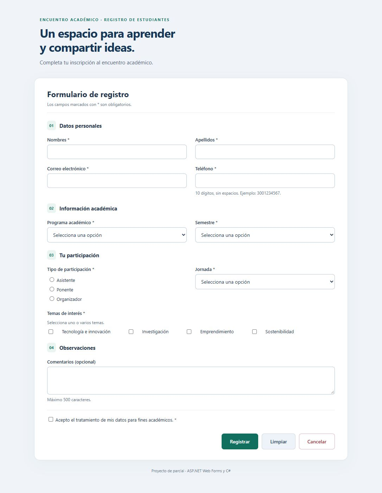
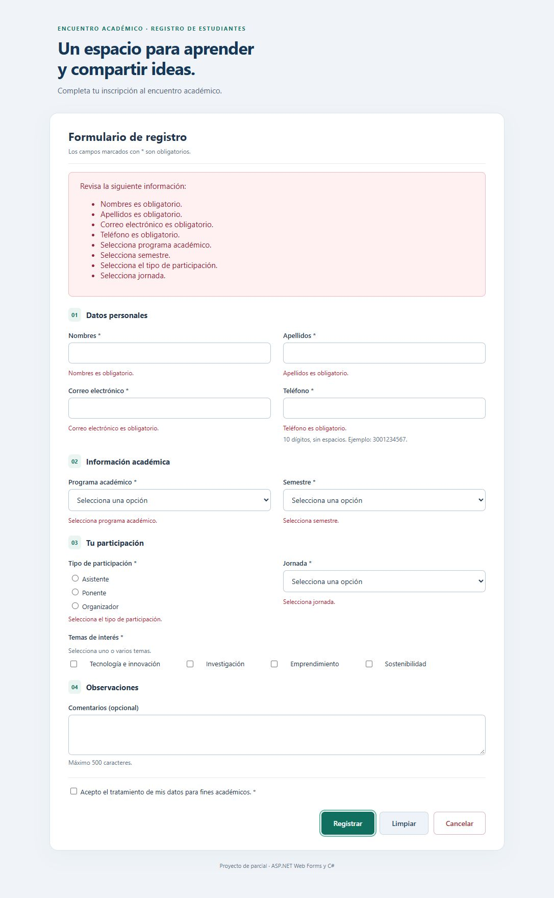
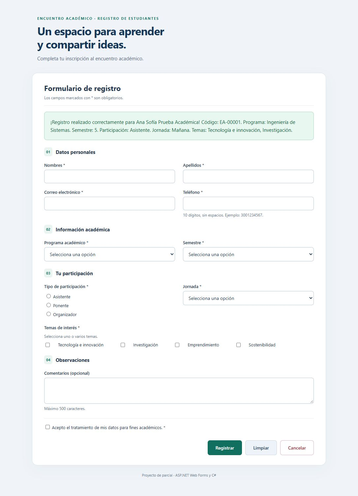

# Registro al Encuentro Académico

Proyecto de **Desarrollo de Aplicaciones Web II**: formulario de inscripción estudiantil con ASP.NET Web Forms, C#, validadores de servidor y persistencia transaccional en SQL Server LocalDB. El objetivo académico es relacionar controles ASPX, eventos C#, validación, catálogos y un modelo relacional.

## Tecnologías y requisitos

Windows, Visual Studio Community 2026 con desarrollo ASP.NET y web, **.NET Framework 4.7.2**, MSBuild, IIS Express y SQL Server LocalDB `(localdb)\MSSQLLocalDB`. Acceso SQL mediante `System.Data.SqlClient`. Este proyecto no requiere paquetes NuGet.

## Abrir y ejecutar

1. Clonar el repositorio y abrir `RegistroEncuentroParcial.sln` en Visual Studio.
2. Iniciar la instancia con `SqlLocalDB start MSSQLLocalDB`.
3. En PowerShell, desde la raíz del repositorio, ejecutar `& .\Sql\Preparar.ps1`. Alternativamente ejecutar `Sql/01-Esquema.sql` y `Sql/02-Catalogos.sql`, en ese orden, en una ventana SQL conectada a la instancia.
4. Revisar `Web.config`: la cadena `EncuentroAcademico` apunta a `EncuentroAcademicoDB` y utiliza autenticación integrada de Windows, sin credenciales SQL. Si la instancia es diferente, adaptar esa cadena localmente.
5. Establecer el proyecto como inicio y `Default.aspx` como página de inicio si fuera necesario; seleccionar IIS Express y pulsar F5. Puerto configurado: `http://localhost:51842/`. Si está ocupado por otra copia, detener esa copia o elegir un puerto local libre en Visual Studio.

Los scripts comprueban la existencia de la base y objetos antes de crearlos; no borran ni reemplazan tablas. No se incluyen archivos MDF/LDF ni exportaciones de bases reales. Los catálogos son ejemplos educativos, sin atribución institucional. La persistencia SQL es una ampliación basada en el modelo de clase; no se atribuye como requisito explícito del PDF del formulario.

## Funcionalidades y validaciones

- Nombres y apellidos obligatorios, hasta 80 caracteres; correo obligatorio de hasta 160 con formato válido; teléfono de exactamente 10 dígitos sin espacios.
- Programa, semestre, participación y jornada obtenidos de catálogos SQL y de selección obligatoria.
- Uno o varios temas de interés; comentarios opcionales hasta 500 caracteres y aceptación obligatoria de tratamiento de datos.
- RequiredFieldValidator, RegularExpressionValidator, CustomValidator, ValidationSummary y comprobaciones en servidor con Page.IsValid.
- Registrar guarda estudiante, registro y temas en una transacción y confirma con nombre, código y resumen; Limpiar restablece sin guardar; Cancelar redirige a una pantalla distinta sin guardar.
- Mensajes codificados en HTML; errores SQL sin detalles internos al navegador; interfaz responsive.

## Modelo SQL

`Estudiantes`, `Registro`, `Programas`, `Semestre`, `TipoParticipacion`, `Tema` y `Jornada` conservan el modelo original. `RegistroTema` agrega la relación de múltiples temas. `Registro.Idtema` es el tema principal (menor ID elegido), y también se incluye en la tabla puente. Dos triggers mantienen esa consistencia; una transacción evita inscripciones incompletas. Detalles: [modelo y explicación](docs/Explicacion-y-trazabilidad.md).

## Estructura

```text
RegistroEncuentroParcial.sln / RegistroEncuentroParcial.csproj
Default.aspx / Default.aspx.cs / Default.aspx.designer.cs
Cancelado.aspx
DatosEncuentro.cs      # Catálogos y transacción SQL
Web.config
Content/              # Estilos
Properties/           # Información del ensamblado
Sql/                  # Esquema, catálogos y preparación
tests/                # Pruebas HTTP/SQL y herramientas de entrega
docs/                 # Modelo, controles, trazabilidad y resultados
Evidencias/           # Capturas y resultados con datos ficticios
```

## Pruebas y límites

El [reporte histórico](docs/Resultados.md) documenta 18/18 pruebas HTTP aprobadas, ejecución en IIS Express, recuperación SQL, temas múltiples y rollback. Las pruebas usan exclusivamente datos ficticios de `example.test`. No se ejecutaron de nuevo durante esta publicación, para conservar las bases sin cambios. La nueva compilación y revisión de fuentes se registran en [verificación de publicación](docs/Verificacion-publicacion.md).

La pulsación de F5 dentro de la interfaz de Visual Studio y la presentación en un móvil físico quedaron pendientes en la verificación original; sí se ejecutó IIS Express directamente. No se inventan comprobaciones adicionales.

Para repetir las pruebas en una instalación de demostración con IIS Express iniciado, usar Python 3: `python tests/servidor.py`. Para comprobaciones conjuntas: `& .\tests\todas.ps1`. Las pruebas válidas **agregan datos ficticios**: ejecutarlas solo en una base académica propia. La prueba SQL invoca la misma clase de persistencia y comprueba rollback.

## Capturas reales

Solo contienen datos ficticios del ejercicio.







## Actualización y clonación

Editar esta copia de Git, revisar Changes en GitHub Desktop, crear un commit y pulsar Push origin. En otro equipo, clonar, preparar LocalDB mediante los scripts y abrir la solución. Con la copia limpia se puede actualizar con `git pull --ff-only`. No se versionan salidas de compilación, bases físicas, secretos ni ZIP duplicados del código.
